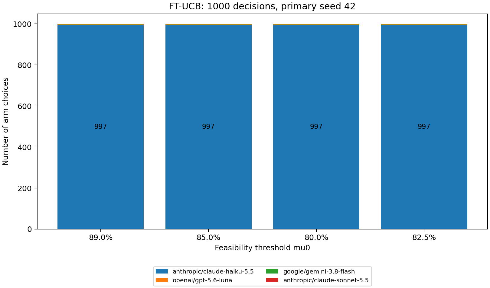
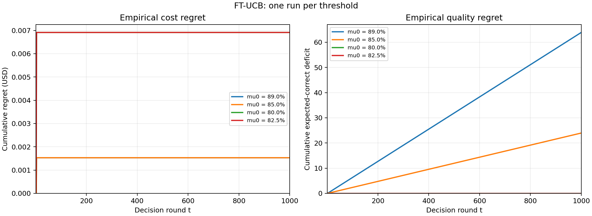

# FT-UCB offline routing experiment

Questions: `C:\Users\24905\Desktop\Project\LLM_Routing\mmmu_test_sample\questions.jsonl`; SHA-256: `d79a94820292303fcb9eb61d92eb1bfda97a2f3aa35675ac4fe9ca59abf77647`.

Saved model outcomes: `C:\Users\24905\Desktop\Project\LLM_Routing\mmmu_test_sample\runs\sequential\results.csv`; SHA-256: `6c232e57a77915b9bc27a5e7ac725041eae60d10f11f56dbaa95497820b2cbbf`.

1000 prompts x 4 arms; 1 shuffled replays. The primary run uses seed 42. No new model calls are made.

Each threshold has 1000 decision rounds, one per MMMU question. Saved outcomes for four arms are a lookup/evaluation table, not extra decision rounds.

[Algorithm 6, Appendix H](https://users.ece.cmu.edu/~oyagan/Conferences/ICLR2025.pdf#page=54): initialize each arm once in ascending fixed-cost order; then choose the cheapest arm whose empirical mean plus sqrt(2 ln(t) / n) reaches mu0. If no arm qualifies, sample uniformly. The bound is not clipped to 1. Cost ties use model name order.

Only the selected arm's outcome updates the policy. Each prompt occurs once per replay with immediate labeled feedback; thresholds share prompt order for each seed.

Fixed costs used by the policy: **full-data mean of known CSV costs**.

Costs are calibrated from all known CSV costs, excluding missing entries, and held fixed. This uses future cost metadata and approximates the paper's known-cost assumption. Use --arm-costs for independently specified costs.

## Arm statistics (full-data evaluation)

| Model | Accuracy | Fixed cost, USD/call | Mean known CSV cost | Missing CSV costs |
| --- | ---: | ---: | ---: | ---: |
| anthropic/claude-haiku-5.5 | 82.60% | 0.000314321 | 0.000314321 | 0 |
| openai/gpt-5.6-luna | 82.50% | 0.000466212 | 0.000466212 | 0 |
| google/gemini-3.8-flash | 90.80% | 0.002929150 | 0.002929150 | 0 |
| anthropic/claude-sonnet-5.5 | 87.80% | 0.004460339 | 0.004460339 | 2 |

## Primary run: totals

| mu0 | Correct | Accuracy | Total CSV cost, USD | Known cost, USD | Missing costs | Fixed-cost total, USD | Cost regret, USD | Quality regret | Cheapest feasible model |
| --- | ---: | ---: | ---: | ---: | ---: | ---: | ---: | ---: | --- |
| 89.0% | 826 | 82.60% | 0.319656 | 0.319656 | 0 | 0.321233 | 0.001531 | 63.885000 | google/gemini-3.8-flash |
| 85.0% | 826 | 82.60% | 0.319656 | 0.319656 | 0 | 0.321233 | 0.001531 | 23.953000 | google/gemini-3.8-flash |
| 80.0% | 826 | 82.60% | 0.319656 | 0.319656 | 0 | 0.321233 | 0.006913 | 0.000000 | anthropic/claude-haiku-5.5 |
| 82.5% | 826 | 82.60% | 0.319656 | 0.319656 | 0 | 0.321233 | 0.006913 | 0.000000 | anthropic/claude-haiku-5.5 |

## Primary run: arm choices

| mu0 | anthropic/claude-haiku-5.5 | openai/gpt-5.6-luna | google/gemini-3.8-flash | anthropic/claude-sonnet-5.5 | Total |
| --- | ---: | ---: | ---: | ---: | ---: |
| 89.0% | 997 | 1 | 1 | 1 | 1000 |
| 85.0% | 997 | 1 | 1 | 1 | 1000 |
| 80.0% | 997 | 1 | 1 | 1 | 1000 |
| 82.5% | 997 | 1 | 1 | 1 | 1000 |




## Regret definitions

Following [Section 1.1](https://users.ece.cmu.edu/~oyagan/Conferences/ICLR2025.pdf#page=2), let mu_i be the full-data accuracy estimate, c_i the fixed policy cost, and a* the cheapest arm with mu_i >= mu0. The plotted empirical path regrets are:

```text
R_cost(t)    = sum_{s=1}^t max(0, c[chosen_s] - c[a*])
R_quality(t) = sum_{s=1}^t max(0, mu0 - mu[chosen_s])
```

Cost regret is in USD; quality regret is in expected-correct-answer equivalents. These plug-in gaps use full-data arm means for evaluation only, never policy updates. An infeasible threshold has cost regret N/A; quality regret remains defined.



## Discussion and limitations

FT-UCB need not reach mu0 in 1000 rounds: optimism can keep cheap infeasible arms in the candidate set. Small cost regret alone does not establish quality feasibility.

Actual costs sum selected CSV entries. With missing costs, the total is N/A and the known sum is a lower bound. Fixed-cost totals/regret use c_i, not per-prompt token costs.

Scorer: tag-first, option-aware deterministic MMMU-style v2 (not the official evaluator). 225 observations are flagged for manual review in scored_results.csv. Automatic scores and all quality comparisons remain provisional until reviewed labels are supplied.

Curves show one sampled path at each threshold by default. With multiple replays, they show means +/- sample SD, approximating path expectations. SD measures order/randomness sensitivity, not uncertainty on unseen prompts.

Full per-run counts and totals are in runs.csv; each decision is in trace.csv. Plots are exported as PNG/PDF for slides.
